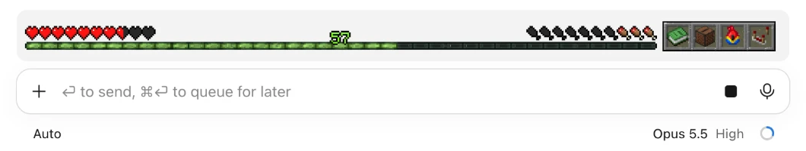
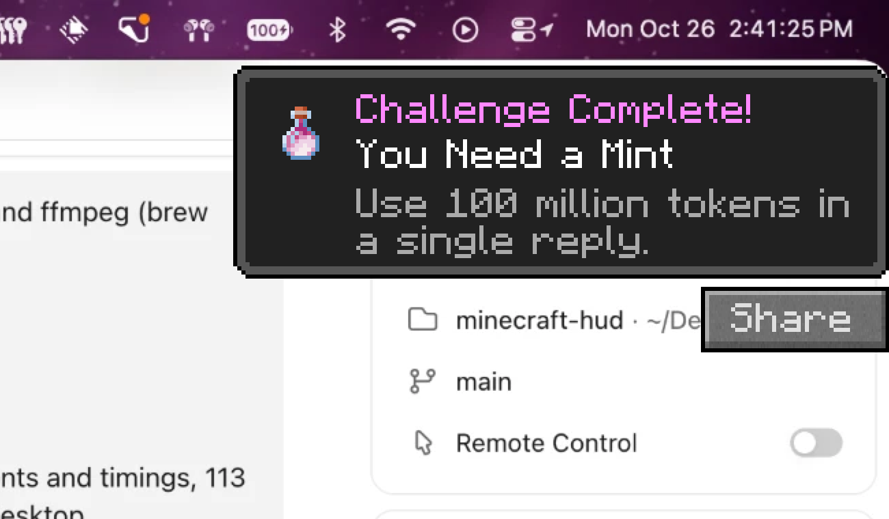
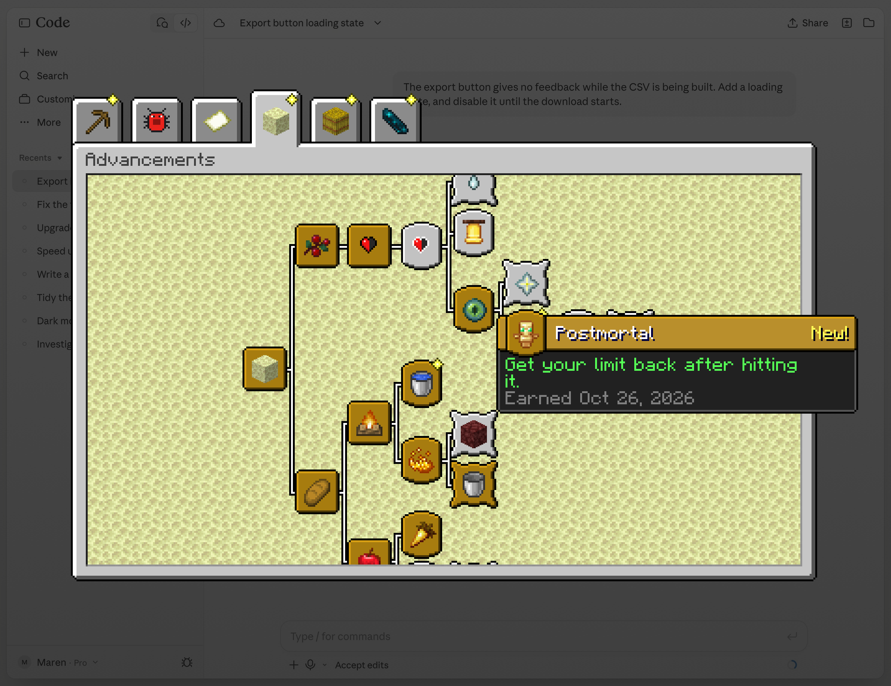
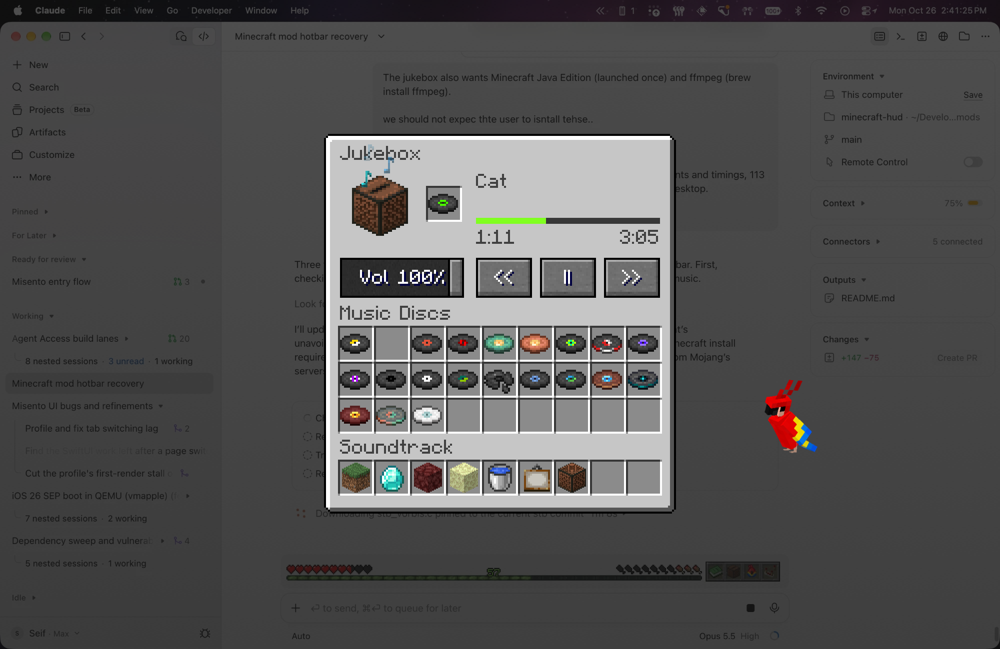

# Minecraft Claude Code Mod

**Claude Code, played as Minecraft survival.** Your usage limit is your hearts. The context window is your hunger. Every token is XP. Hit your limit and you die; compact a chat and you eat a golden apple; ship a pull request and an advancement slides into the corner.



## Install

```bash
claude plugin marketplace add 3eif/minecraft-claude-code && claude plugin install minecraft-hud@minecraft-hud
```

Or inside Claude Code: `/plugin marketplace add 3eif/minecraft-claude-code`, then `/plugin install minecraft-hud@minecraft-hud`.

Start a new chat. A four-page guide opens the first time (`/minecraft help` brings it back).

Needs **macOS 12+** (Apple Silicon or Intel) and the **Claude Code desktop app** for the pixel HUD; in a terminal you get a one-line HUD, and the full-screen moments and parrot still work. Nothing else to install.

## What you get

**The HUD**, above the prompt. Hover it for the figures.

| In the game | In Claude Code |
|---|---|
| **Hearts** | Your usage limit: the 5-hour or the weekly, whichever you've used more of. Each heart is 10%. |
| **Hunger** | The context window, emptying as the chat fills. |
| **XP** | Every token you use, across all chats. Level 50 is about a year of heavy use. |

**The hotbar**, beside it: **Advancements**, **Jukebox**, **Parrot** and **Settings**, one click each.

**Moments**, over the whole screen, with the game's sounds:

- **Damage** as your limit drains: the hearts flash and shake.
- **The death screen** when you hit it: *"Claude was slain by the weekly limit."* In bypass-permissions mode, it's hardcore.
- **Totem of Undying** when your weekly limit resets: once, small, quiet.
- **Golden apple** when a chat compacts, the **level-up** chime, a **villager's "hmm"** when Claude asks you something.

**113 advancements** in six tabs (Building, Combat, Exploration, Survival, Habits, and The Deep Dark, which opens at 50). They start easy and run deep: the last tiers take a heavy user months, and some are secret. Each toast stays ten seconds, and hovering it shows a **Share** button; the tree shows when you earned each one and stars what's new.





**The jukebox** plays every music disc and the whole soundtrack, and keeps playing after you close it. It reads them from your Minecraft install if you have one, and otherwise fetches each track from Mojang's servers the first time it plays. **The parrot** sits on your desktop, watches your pointer, and dances while the jukebox plays.



## Commands

Everything lives under `/minecraft`.

| Command | What it does |
|---|---|
| `/minecraft advancements` · `music` · `parrot` · `settings` | Open a hotbar screen |
| `/minecraft help` | The guide |
| `/minecraft music pause` · `next` · `prev` · `stop` | Control the jukebox without opening it |
| `/minecraft volume 50` · `mute` · `unmute` | Sound |
| `/minecraft hotbar on\|off` · `fullscreen on\|off` | Hide the hotbar, or keep moments inside the app |
| `/minecraft death` · `totem` · `damage` · `apple` · `xp` · `advancement` | Preview a moment |
| `/minecraft live` | Back to your real figures after a preview |
| `/minecraft clear` | Reset XP; advancements stay |
| `/minecraft reset all confirm` | Start over completely (settings stay) |

## Shortcuts

| Where | What to do |
|---|---|
| **Any screen** | `Esc` closes it; so does a click outside the tree or the jukebox |
| **Advancements** | Drag, scroll or swipe to move around; `L` closes it, as in the game |
| **Jukebox** | `Space` pauses; click or drag the track to seek; `Delete` leaves an album; `E` closes it |
| **Music, anywhere** | The keyboard's play/pause and skip keys, Control Center's Now Playing, and headphone taps control the jukebox |
| **Guide** | `→` / `Return` next, `←` back |
| **Settings** | `Return` or `Esc` goes back a page |
| **Toasts** | Hover to keep one up and show **Share**, which sends a picture of it |
| **Parrot** | Drag it anywhere; click and it hops; right-click for a new coat |

## How it works

The mod is two parts.

**The hooks** (`hooks/`) run inside Claude Code. They draw the HUD and hotbar, read your usage, context and tokens as Claude Code reports them, count what Claude does (edits, commits, tests, tools), and award advancements. Every open chat runs its own copy and they share one record, so a setting changed in one chat shows in the others, and a moment like the totem plays once however many chats you have open.

**The helper** (`overlay/MCOverlay`) is a small native Mac program, written in Swift, that draws everything outside the app window: the screens, the full-screen moments, the toasts, the parrot. There is nothing to install for it separately:

- It ships **prebuilt** in the plugin, one universal binary for Apple Silicon and Intel. `claude plugin install` downloads it with the rest of the plugin into `~/.claude/plugins/cache/`.
- It isn't placed in Applications, has no Dock icon, adds no login item, and asks for no permissions. The hooks start it the first time a chat needs it.
- It stays running in the background so screens open instantly, idling at well under 1% CPU. It quits when Claude Code quits, after half a day unused, or when a plugin update replaces it.

Want to build it yourself? `overlay/build.sh` (needs Xcode's command-line tools).

## Your data

Nothing about you leaves your Mac; the only network use is the jukebox fetching music from Mojang when Minecraft isn't installed. Progress, XP and settings live in Claude Code's plugin storage, with a copy in `~/Library/Application Support/minecraft-hud/backup.json` (refreshed daily and on every advancement). If a reinstall, or installing from another marketplace, starts the mod empty, your progress comes back from that copy. Restarts, updates and switching Claude accounts keep everything; advancements belong to this Mac, not an account.

## Updating

Claude Code doesn't update plugins from GitHub marketplaces on its own. To have it do so, in Claude Code run `/plugin`, open **Marketplaces**, choose **minecraft-hud** and pick **Enable auto-update**. New versions then install in the background, and load after `/reload-plugins` or a restart.

Or update by hand, then restart Claude Code:

```bash
claude plugin update minecraft-hud@minecraft-hud
```

## Uninstall

```bash
claude plugin uninstall minecraft-hud@minecraft-hud
```

To remove what it keeps too (the music it fetched lives in the cache):

```bash
rm -rf ~/Library/Caches/minecraft-hud ~/Library/Application\ Support/minecraft-hud
```

## Notes

- The hotbar's click areas are buttons laid over pictures, a layout a future Claude Code update could break. Issues welcome.
- Tests: `claude plugin test .`

## Disclaimer

Not an official Minecraft product. Not approved by or associated with Mojang or Microsoft. Not an official Anthropic product either. Minecraft's textures and sounds are Mojang's. The music isn't included: it's read from your Minecraft install or fetched from Mojang's own servers.
